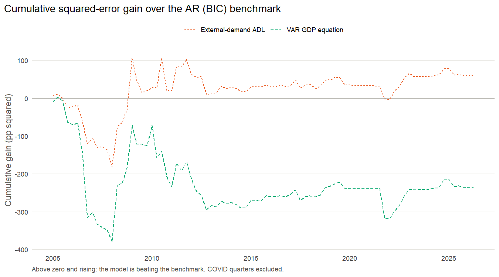

# Forecasting Singapore's GDP Growth

  

**Forecasting Singapore's GDP growth using simple econometric models, and understanding if foreign demand helps make a better forecast?**

The project is an extension of the coursework done from my Econometrics class in Bocconi, and tests six models (one-quarter-ahead forecasts), each trained on data available at the time. 

| | |
|---|---|
| **Data** | Quarterly, 1975Q1–2026Q2. Sources: SingStat, Ministry of Manpower, FRED (US and euro-area GDP, Fed funds rate, BIS exchange rate) |
| **Models** | Historical mean, random walk, AR(p), domestic ADL, external-demand ADL, VAR(2) |
| **Evaluation** | RMSE, MAE, bias, Diebold–Mariano tests; expanding vs 15-year rolling estimation window |
| **Tools** | R (dplyr, ggplot2), data download with official APIs |

## Key findings

1. **None of the models beat the simple AR benchmark.** Models with the best performance reduce forecast error by ~ 1–2%, and the Diebold–Mariano test of the gains is not significant. Quarter-on-quarter growth in Singapore is mostly noise.
2. **Foreign demand is important during globally significant economic events.** During the financial crisis (2008–09), the external-demand model outperforms the AR model (RMSE 10.7 vs 11.6). In other periods however, it adds little.
3. **Simple models have an over-forecasting problem post 2010, because Singapore's GDP growth trend dropped.** Average growth dropped from 8.1% (2005–07) to 4.4% (2010–19). Simple models were estimated on data going back to 1975, and therefore over-forecasted ~ 1.7 – 2.2 pp on average in during the 2010-19 period.
4. **A rolling window estimation fixes the bias, limited to the simplest models.** Using a 15-year window, the historical mean's 2010–19 bias almost halves (2.16 to 1.03 pp) and its RMSE (6.12) becomes the lowest. However, models using explanatory variables perform worse since they lose data points.

*Rising line indicates that the model is beating the AR benchmark over that stretch.*

## Adapting the coursework project to a Singapore context:

Originally a Bocconi econometrics group project on Croatia, adapting it to Singapore meant adapting the model as well as the data:
| Croatia version | Singapore version | Why |
|---|---|---|
| Annual data, 20 observations | Quarterly data, 125 quarters since 1995 (GDP since 1975) | More data for estimation and testing |
| Interest rate as the policy variable | Exchange rate (S$NEER), incorporating the US Fed funds rate as an external factor | MAS has a unique monetary policy where they manage Singapore's exchange rate considering that it is a small and import-reliant country |
| Current account balance | US and euro-area GDP growth | Singapore's business cycle is heavily linked to foreign economic conditions |
| Same-year regressors | Regressors lagged one quarter | Real forecasts: only information available at the time |
| AR(2) and VAR(2), compared on RMSE | Lag length chosen by BIC; DM tests; bias by period; rolling window | Tests if there are significant differences, and tries to understand why models fail |

## Course concepts applied

- **Time-series models:** OLS, autoregressive distributed lag (ADL) models, AR(p) with BIC lag selection, VAR.
- **Out-of-sample forecasting:** each forecast uses only data available at the time (t-1), comparison of expanding and rolling estimation windows.
- **Forecast evaluation:** RMSE, MAE, bias, Diebold–Mariano tests of equal accuracy with the Harvey–Leybourne–Newbold small-sample correction.
- **Outliers:** COVID quarters kept out of estimation (also the quarters whose lags fall in the COVID periods)
**Limitations:** forecasts use present day revised data instead of originally published data at the time, which would make real-time errors larger. 
**Next step:** nowcasting using monthly indicators (exports, financial conditions, payment & spending data etc.) to estimate the quarter before the official figure is released.

---
To reproduce, run `code/01_download.R` and then `code/02_forecast.R` from the repository root.
